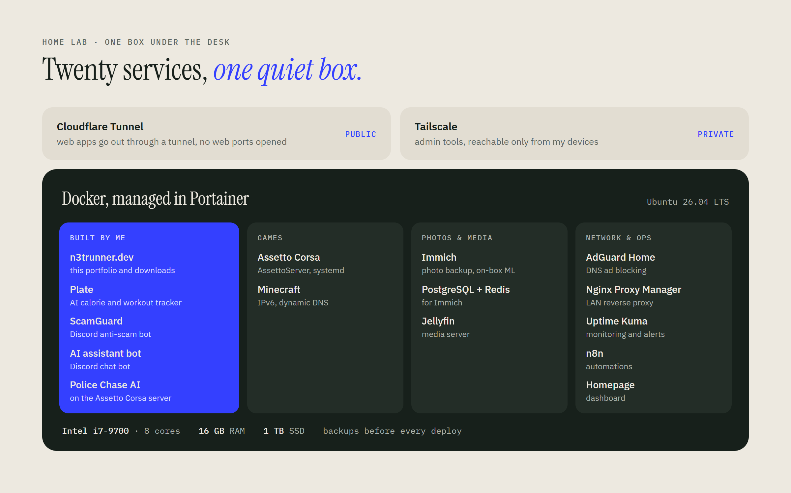
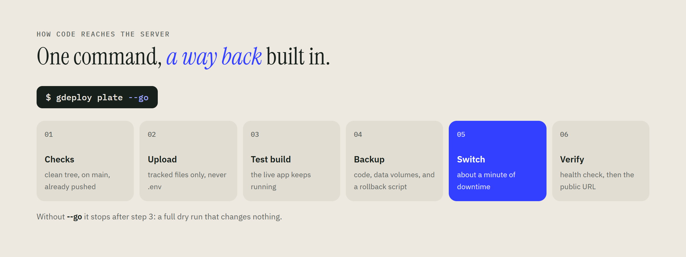

# Home lab

**One Linux box that runs my sites, bots, game servers and family photos.** Everything lives in Docker, the web apps
reach the internet through a Cloudflare Tunnel, and the admin tools stay private on Tailscale.

## Deploying without fear

Every app ships with one command. It refuses to deploy anything that isn't committed and pushed, test-builds on the
server while the live app keeps running, and writes a rollback script before switching.

| Script | What it does |
|---|---|
| [`tools/gdeploy.sh`](tools/gdeploy.sh) | Deploys a project to the server: dry run by default, `--go` for real, backups and rollback every time |
| [`tools/gsync.sh`](tools/gsync.sh) | Keeps every project the same on every PC and on GitHub. Never force-pushes, and refuses to commit `.env` files, keys or anything that looks like a token |

Each project carries a small `deploy.conf` (server, folder, container, files to keep) that `gdeploy` reads.

## What I learned running it

- **No inbound web ports.** A tunnel that connects out is simpler and safer than port forwarding and a reverse proxy on the router.
- **Back up before you change, not after.** Data volumes are archived before every deploy, so a bad release costs a minute, not a database.
- **Watch it, don't trust it.** Uptime Kuma checks the services, and a deploy ends by checking the container's health and the public URL.
